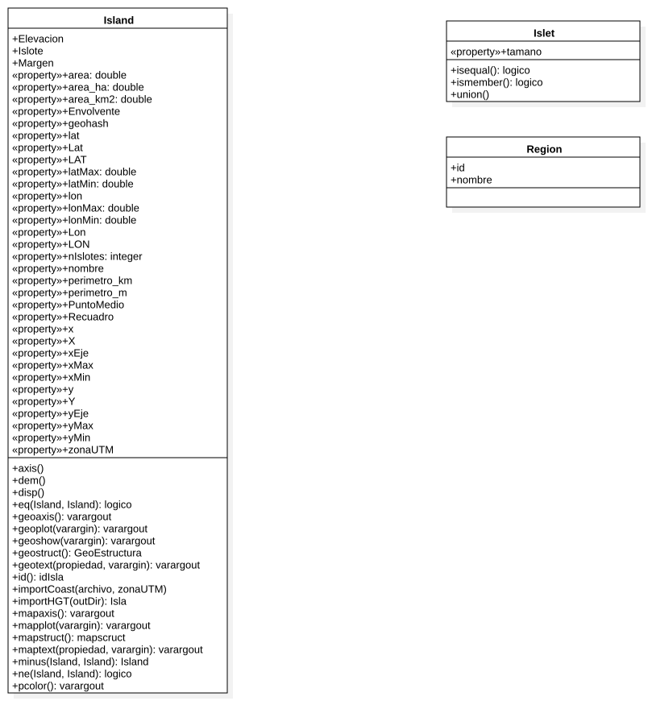

Clase Insular
====

Notas
----
- La clase **Insular** es la composición de dos clases:
    - Region
    - Islet
- **Region** e **Islet** son subclases de _Geopolygon_
- El constructor de **Region** recibe como argumento un objeto de clase RegionID la cual es una clase de enumeración. Los objetos de clase **Region** son como los objetos de clase _Geopolygon_ pero con nombre.
- En versiones anteriores, **Geopolygon** era una subclase de _geoshape_, pero ya no es así porque era muy difícil programar los constructores de las subclases. Los objetos se comportaban de una manera inesperada dentro de los constructores.

El paso siguiente
----
- Verificar que corran (publish) todos los programas que se encuentran en el
directorio de demostraciones para después convertirlos a pruebas y pasarlos al directorio `tests/`

To-do
----
- Agregar regiones nuevas de forma amigable
- Mover el método `convhull` y propiedad `envolvente` de _Geopolygon_ a _Islet_ porque `convhull` no acepta NaNs (o quita los NaNs antes de calcular la envolvente?)
- Los nombres de las clases no cumplen con la guía de estilo de nomenclatura
- Se deben convetir a pruebas los programas que se encuentran en el forder de demostraciones y pasarlos al directorio `tests/`

### Estado actual

